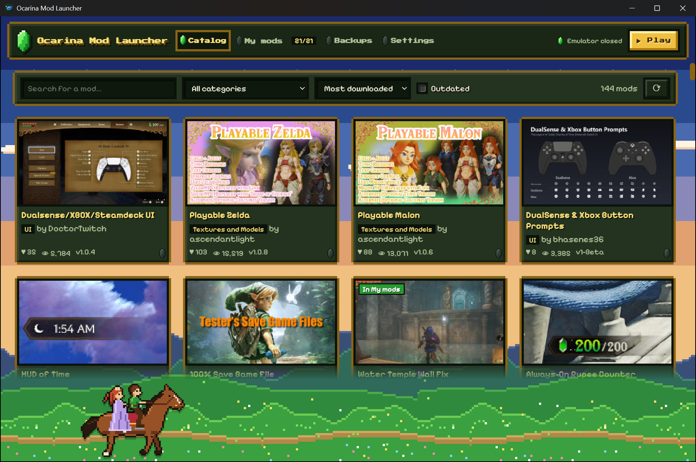
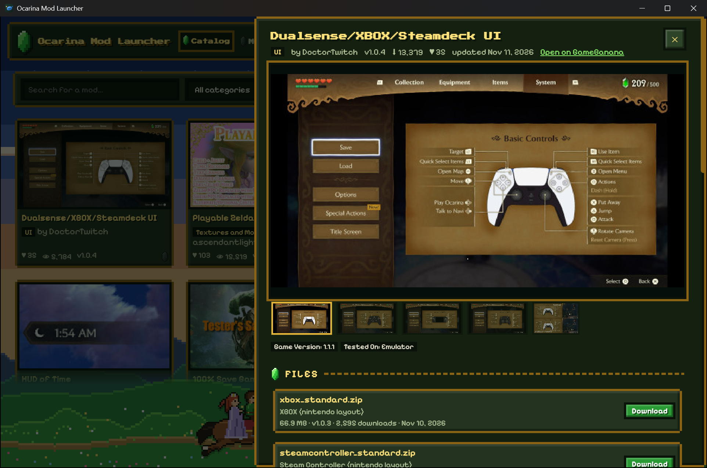
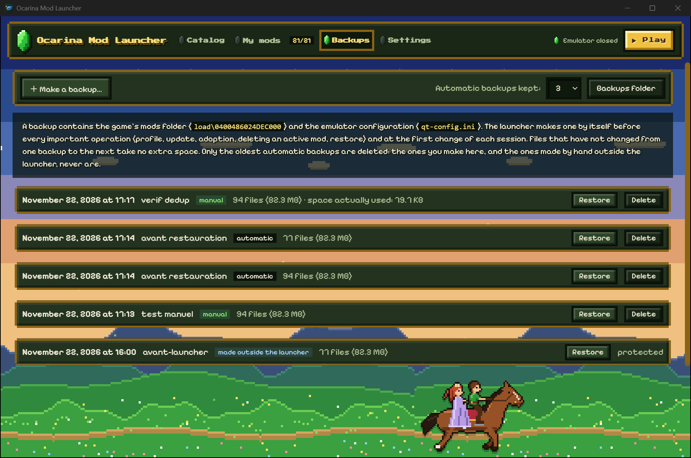
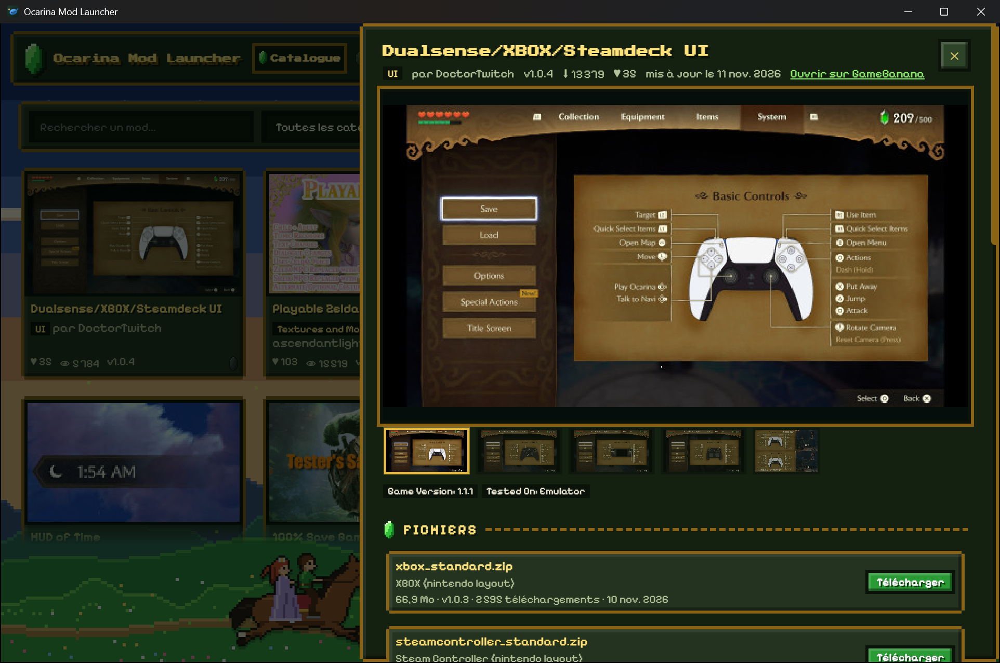
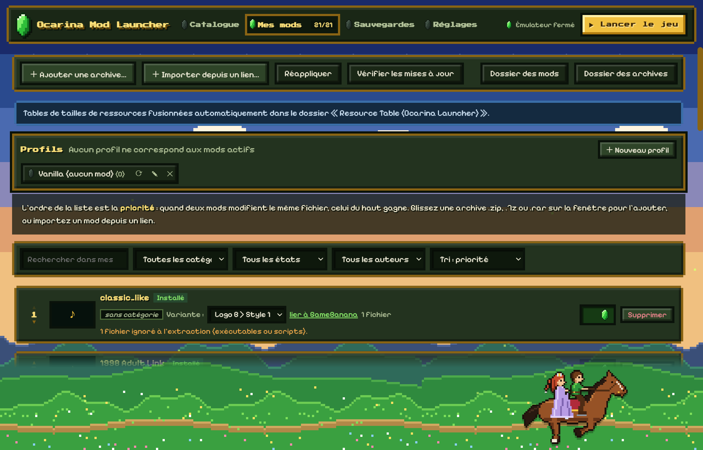
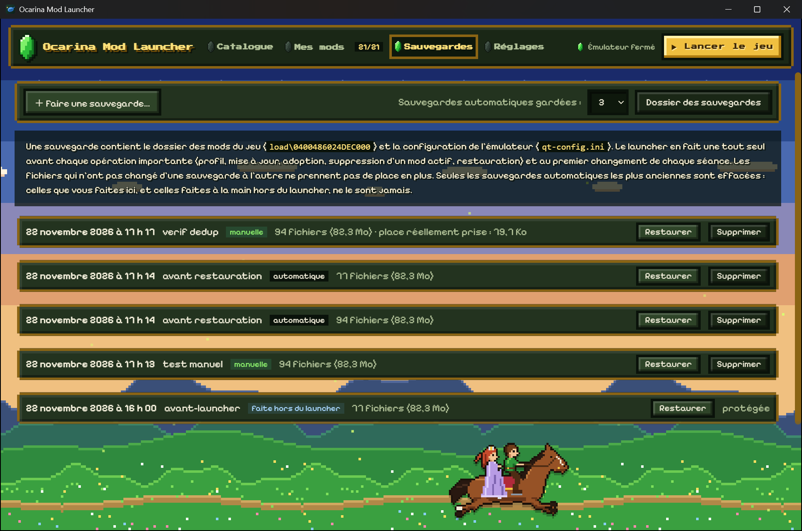

<h1 align="center">Ocarina Mod Launcher</h1>

  <b>Mod manager for <i>Ocarina of Time</i> (Switch 2) on emulator</b> 
  <i>Gestionnaire de mods pour Ocarina of Time (Switch 2) sur émulateur</i>

  <a href="https://github.com/ArthropodeLabs/ocarina-mod-launcher/releases/latest"><b>⬇ Download / Télécharger</b></a>
  &nbsp;·&nbsp;
  <a href="#english">English</a>
  &nbsp;·&nbsp;
  <a href="#français">Français</a>
  &nbsp;·&nbsp;
  <a href="https://ko-fi.com/arthropodelabs">☕ Ko-fi</a>

---

## English

Ocarina Mod Launcher installs, enables and sorts out mods for *Ocarina of Time* (Switch 2 version) on the Fritchii, Lichii and Eden emulators. No more copying folders by hand, ticking mods in the emulator, or guessing which mod overrides another: one switch per mod, and the launcher handles the rest.

> **Important.** The launcher does **not provide the game, ROMs, keys or an emulator**. You must own the game and the emulator yourself. It ships no game files and uses no Nintendo artwork: the pictures in the catalog are the ones mod authors publish on GameBanana.

### Features

- Built-in **GameBanana catalog**: search, categories, sorting, mod page with pictures, files and variants, one-click download. Each mod's author is credited up front, with a "Support the author" button. The catalog stays browsable offline.
- **My mods**: one switch per mod, variant choice, priority order by drag and drop, search, filters (category, status, author) and sorting (name, category, author, date added).
- **Automatic conflict handling**: when two mods change the same file, the one on top wins, and the launcher clearly shows what overrides what. Resource size tables from every mod are merged automatically, and incompatible code mods are blocked with a message.
- **Enabled in the emulator** without ticking anything.
- **Profiles**: switch from one set of mods to another (or to the unmodded game) in one click.
- **Mod updates**: the launcher spots new versions on GameBanana and installs them while keeping your settings, one by one or all at once.
- **Launcher auto-update**: a banner offers the new version, checked with a signature, then installed in one click.
- **Import** an archive (.zip, .7z, .rar) by drag and drop or from a link (GitHub, direct link, Dropbox, Google Drive).
- **Adopt** mods you already installed by hand.
- Automatic **backups** before every important change, and one-click restore.
- One-click **bug report** (Settings > Updates and help).
- **French and English** interface, retro "16-bit Adventure" theme.
- **Play** button.

| My mods | Backups |
|---|---|
|  |  |

### Installation

1. Download `OcarinaModLauncher_0.1.0_x64-setup.exe` from the [releases page](https://github.com/ArthropodeLabs/ocarina-mod-launcher/releases/latest).
2. Run it. **Windows SmartScreen will probably show "Windows protected your PC"**: this is expected, the program is not yet signed with a paid certificate. Click **More info**, then **Run anyway**.
3. Follow the installer (no administrator rights needed).
4. On first launch, open **Settings**: the launcher looks for the emulator by itself. Otherwise, point it to the folder that contains `fritchii.exe` (or `lichii.exe`, `eden.exe`).

**Requirements**: Windows 10 or 11 (64-bit), a Fritchii, Lichii or Eden emulator with the game, and an Internet connection for the catalog.

### FAQ

**Is it a virus? SmartScreen warns me.**
No. SmartScreen warns about any new program that has no paid signature or reputation yet. Only download it from this page: each installer's SHA-256 fingerprint is listed in the release notes. On startup, the launcher itself checks that it has not been tampered with.

**Does the launcher contain the game or Nintendo files?**
No, nothing. It only stores and enables the mods you choose.

**Will it touch mods I installed by hand?**
No. It only changes folders it created itself (marked with a `.ocarina-launcher` file). To let it manage an existing mod, use the "Adopt" button.

**Does the emulator need to be closed?**
Yes. The emulator rewrites its configuration when it quits, so the launcher refuses to write while it is open.

**A mod doesn't work.**
Some mods are not made for emulators (for example those for the recompiled PC version). The launcher flags them as incompatible. Also check the chosen variant and the priority order. To go back, use the Backups tab.

**Does the launcher need Internet?**
For the catalog, downloads and updates, yes. Everything else works offline.

**How do I update the launcher?**
It offers the update by itself on startup when a new version is out. You can also download the latest installer here and install it over the old one: your settings and mods are kept.

**Can I share it?**
Yes, by sharing the link to this page. Please don't re-upload the installer elsewhere (see the license).

### License

**Free software, all rights reserved.** You may use it freely, but not sell, redistribute or modify it without the author's permission. Full text: [LICENSE.txt](LICENSE.txt). If you paid for it, or found it anywhere other than this page, it is not an authorized copy.

Unofficial fan project, not affiliated with Nintendo or the emulator authors. *The Legend of Zelda* and *Ocarina of Time* are trademarks of Nintendo.

### Credits

- Mods belong to their authors, published on [GameBanana](https://gamebanana.com/). Thank you to them.
- [Press Start 2P](https://fonts.google.com/specimen/Press+Start+2P) and [Pixelify Sans](https://fonts.google.com/specimen/Pixelify+Sans) fonts, SIL Open Font License.
- Original pixel art scenery and characters.
- Made by **ArthropodeLabs**.

### Support

The launcher is and will stay free. If you like it, you can buy me a coffee on **[Ko-fi](https://ko-fi.com/arthropodelabs)**. To report a problem, use "Copy a bug report" in Settings and paste it into an [issue](https://github.com/ArthropodeLabs/ocarina-mod-launcher/issues).

---

## Français

Ocarina Mod Launcher installe, active et départage les mods d'*Ocarina of Time* (version Switch 2) pour les émulateurs Fritchii, Lichii et Eden. Plus besoin de copier des dossiers à la main, de cocher les mods dans l'émulateur ou de deviner quel mod en écrase un autre : un interrupteur par mod, et le launcher s'occupe du reste.

> **Important.** Le launcher ne fournit **ni le jeu, ni ROM, ni clés, ni émulateur**. Vous devez posséder le jeu et l'émulateur vous-même. Il n'embarque aucun fichier du jeu et n'utilise aucun visuel de Nintendo : les images que vous voyez dans le catalogue sont celles publiées par les auteurs de mods sur GameBanana.

### Fonctions

- **Catalogue GameBanana** intégré : recherche, catégories, tri, fiche du mod avec images, fichiers et variantes, téléchargement en un clic. L'auteur de chaque mod est mis en avant, avec un bouton « Soutenir l'auteur ». Le catalogue reste consultable hors ligne.
- **Mes mods** : un interrupteur par mod, choix de la variante, ordre de priorité par glisser-déposer, recherche, filtres (catégorie, état, auteur) et tri (nom, catégorie, auteur, date d'ajout).
- **Conflits gérés tout seuls** : quand deux mods modifient le même fichier, celui du haut gagne, et le launcher affiche clairement qui écrase quoi. Les tables de tailles de ressources de tous les mods sont fusionnées automatiquement, et les mods de code incompatibles sont bloqués avec un message.
- **Activation dans l'émulateur** sans rien cocher.
- **Profils** : passez d'une sélection de mods à une autre (ou au jeu sans mods) en un clic.
- **Mises à jour des mods** : le launcher repère les nouvelles versions sur GameBanana et les installe en gardant vos réglages, une par une ou toutes d'un coup.
- **Mise à jour automatique du launcher** : un bandeau propose la nouvelle version, vérifiée par une signature, puis installée en un clic.
- **Import** d'une archive (.zip, .7z, .rar) par glisser-déposer ou par lien (GitHub, lien direct, Dropbox, Google Drive).
- **Adoption** des mods déjà installés à la main.
- **Sauvegardes** automatiques avant chaque changement important, et restauration en un clic.
- **Rapport de bug** en un clic (Réglages > Mises à jour et aide).
- Interface en **français et en anglais**, thème rétro « Aventure 16 bits ».
- Bouton **Lancer le jeu**.

| Mes mods | Sauvegardes |
|---|---|
|  |  |

### Installation

1. Téléchargez `OcarinaModLauncher_0.1.0_x64-setup.exe` depuis la [page des versions](https://github.com/ArthropodeLabs/ocarina-mod-launcher/releases/latest).
2. Lancez-le. **Windows SmartScreen va probablement afficher « Windows a protégé votre ordinateur »** : c'est normal, le programme n'est pas encore signé avec un certificat payant. Cliquez sur **Informations complémentaires**, puis sur **Exécuter quand même**.
3. Suivez l'installeur (pas besoin de droits administrateur).
4. Au premier lancement, ouvrez **Réglages** : le launcher cherche l'émulateur tout seul. Sinon, indiquez le dossier qui contient `fritchii.exe` (ou `lichii.exe`, `eden.exe`).

**Configuration requise** : Windows 10 ou 11 (64 bits), un émulateur Fritchii, Lichii ou Eden avec le jeu, et une connexion Internet pour le catalogue.

### FAQ

**Est-ce que c'est un virus ? SmartScreen me met en garde.**
Non. SmartScreen avertit pour tout programme récent qui n'a pas encore de signature payante ni de réputation. Téléchargez-le uniquement depuis cette page : l'empreinte SHA-256 de chaque installeur est donnée dans les notes de version. Au démarrage, le launcher vérifie lui-même qu'il n'a pas été modifié.

**Le launcher contient-il le jeu ou des fichiers de Nintendo ?**
Non, rien. Il ne fait que ranger et activer les mods que vous choisissez.

**Est-ce qu'il touche à mes mods installés à la main ?**
Non. Il ne modifie que les dossiers qu'il a créés lui-même (repérés par un fichier `.ocarina-launcher`). Pour qu'il gère un mod existant, utilisez le bouton « Adopter ».

**L'émulateur doit-il être fermé ?**
Oui. L'émulateur réécrit sa configuration en quittant, donc le launcher refuse d'écrire tant qu'il est ouvert.

**Un mod ne marche pas.**
Certains mods ne sont pas faits pour émulateur (par exemple ceux pour la version PC recompilée). Le launcher les signale comme incompatibles. Vérifiez aussi la variante choisie et l'ordre de priorité. Pour revenir en arrière, utilisez l'onglet Sauvegardes.

**Le launcher a-t-il besoin d'Internet ?**
Pour le catalogue, les téléchargements et les mises à jour, oui. Le reste marche hors ligne.

**Comment mettre à jour le launcher ?**
Il vous le propose tout seul au démarrage quand une nouvelle version sort. Vous pouvez aussi télécharger le dernier installeur ici et l'installer par-dessus : vos réglages et vos mods sont gardés.

**Je peux le partager ?**
Oui, en partageant le lien de cette page. Merci de ne pas republier l'installeur ailleurs (voir la licence).

### Licence

Logiciel **gratuit, tous droits réservés**. Vous pouvez l'utiliser librement, mais pas le revendre, le redistribuer ni le modifier sans l'accord de l'auteur. Texte complet : [LICENSE.txt](LICENSE.txt). Si vous avez payé pour l'obtenir, ou l'avez trouvé ailleurs que sur cette page, ce n'est pas une copie autorisée.

Projet de fan non officiel, sans lien avec Nintendo ni avec les auteurs des émulateurs. *The Legend of Zelda* et *Ocarina of Time* sont des marques de Nintendo.

### Crédits

- Les mods appartiennent à leurs auteurs, publiés sur [GameBanana](https://gamebanana.com/). Merci à eux.
- Polices [Press Start 2P](https://fonts.google.com/specimen/Press+Start+2P) et [Pixelify Sans](https://fonts.google.com/specimen/Pixelify+Sans), licence SIL Open Font.
- Décor et personnages en pixel art originaux.
- Développé par **ArthropodeLabs**.

### Soutenir

Le launcher est et restera gratuit. Si il vous plaît, vous pouvez offrir un café sur **[Ko-fi](https://ko-fi.com/arthropodelabs)**. Pour signaler un problème, utilisez « Copier un rapport de bug » dans les Réglages et collez-le dans une [issue](https://github.com/ArthropodeLabs/ocarina-mod-launcher/issues).
